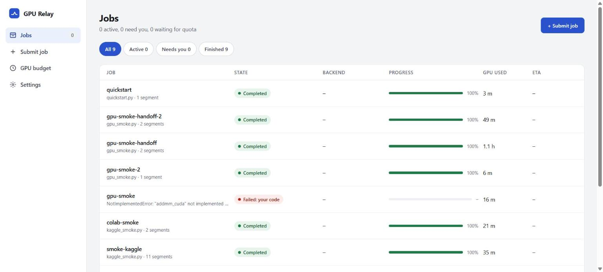
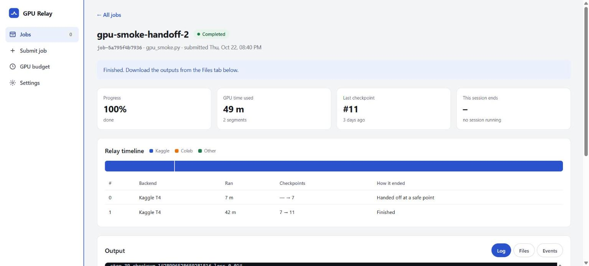
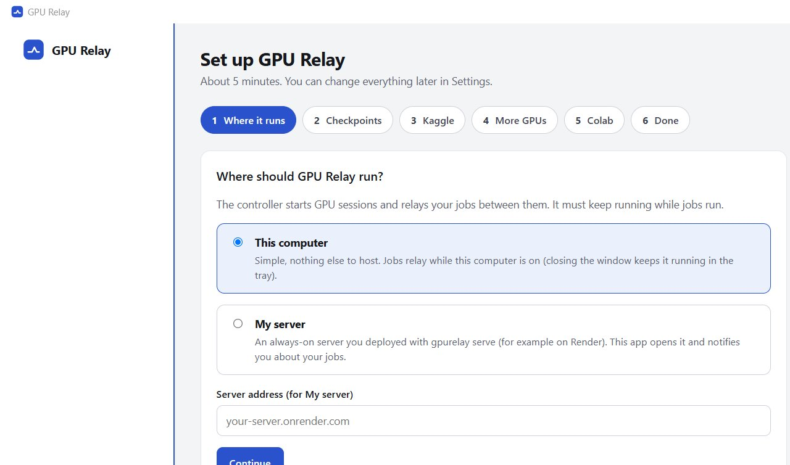
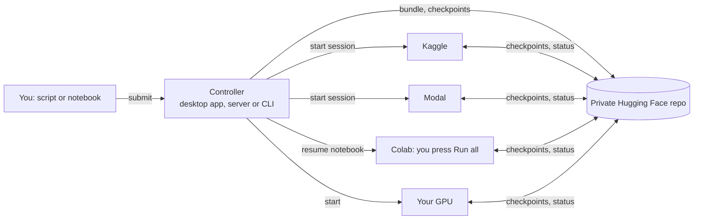

# GPU Relay

Run long machine-learning jobs (training, evaluation, metrics such as FID, preprocessing) to
completion **at the lowest GPU cost: free first**. GPU Relay checkpoints your job
automatically, hands it off before a session or quota limit is hit, and resumes it on another
platform. It uses free GPU hours and free credits first, then Colab; paid GPU time only within
limits you set, and every limit is $0 until you raise it. The final outputs are the same as an
uninterrupted run.

You keep writing ordinary Python scripts or notebooks. Most of them need no changes.

**Website:** https://gpu-relay-9uuh.onrender.com: sign up, connect your own Hugging Face and
Kaggle accounts, and relay your jobs. Each account sees only its own jobs. (A free server: the
first visit after a quiet spell takes about a minute to wake it.)



| A job relayed between two Kaggle sessions | The desktop app's setup wizard |
|---|---|
|  |  |

## What it does

- **Never lose work to a session limit.** Your job checkpoints at safe points in its loops and
  hands off before a Kaggle session (12 h), a quota, or a Colab disconnect ends it.
- **Lowest cost, free first.** One job relays across platforms in this order:
  1. free GPU hours and free credits (credits that expire this month first, then the fastest
     GPU, then the most hours left);
  2. Colab (free, but you press Run all). Set Colab to go **first** to be asked before
     Kaggle and Modal; if you don't press Run all within 30 minutes, the job uses them;
  3. paid GPU time, only if you allowed it for this job *and* set a monthly limit above $0
     for the platform: the cheapest per unit of work, and a session ends before it could pass
     either limit. Both limits are $0 by default, so GPU Relay never charges you unless you
     ask it to.
- **Same results as one long run.** Resumed runs replay your script, restore the variables,
  random generators and files, and continue: logs and outputs match an uninterrupted run.

| Platform | Free | Paid after free | How GPU Relay uses it |
|---|---|---|---|
| Kaggle | about 30 GPU-hours a week (T4/P100) | none | automatic, through Kaggle's official API; always private |
| Modal | $30 of compute a month (about 50 T4-hours), once a payment method is on the account | $0.59/h for a T4, only within your monthly limit (default $0) | automatic, through Modal's official SDK (you confirm its terms first) |
| Your own NVIDIA GPU | unlimited | none | automatic; detected with `nvidia-smi` |
| Google Colab | varies, not guaranteed | none | manual: GPU Relay prepares a resume notebook, you press Run all |
| Lightning AI | some credits a month | — | paused: Lightning closed its platform to all users after a security incident (Oct 2026) |
| Paperspace | free notebooks are public | — | not used: GPU Relay keeps your code and data private |

A platform that refuses to start a session (for example Modal without a payment method) is
shown as **Unavailable** and put on hold; jobs use the other platforms meanwhile.

## Three ways to use it

### 1. Desktop app (Windows)

Download `GPU-Relay-<version>-windows-x64.zip` from the
[Releases page](https://github.com/sailokesh3229/GPU-Relay/releases), unzip it anywhere and run
**GPU Relay.exe**. No Python needed for Kaggle, Modal and Colab.

- A setup wizard asks where GPU Relay runs (**this computer** or **your server**), then for
  your Hugging Face, Kaggle and (optional) Modal tokens. Tokens go to Windows Credential
  Manager or the platforms' own token files, never into config files or logs.
- The window shows your jobs, a job's relay timeline and live log, the GPU budgets, and a
  Submit screen with a resumability check. Closing the window keeps GPU Relay running in the
  tray; it notifies you when a job finishes or needs you on Colab.
- Running jobs on your own computer from the packaged app needs Python 3.10+ installed
  (python.org); GPU Relay prepares its own environment on first use and installs each job's
  `requirements.txt` there, as cloud sessions do. Nothing else is installed on your computer:
  cloud jobs run on the platforms, with their libraries installed inside each session.

### 2. The website (many users)

`gpurelay gateway` runs a website with accounts: each person signs up, connects their own
platforms, and gets their own GPU Relay, so jobs keep relaying while their laptop is off.
Nobody sees anyone else's jobs or tokens, and the server holds no platform tokens of its own.

**What each user needs** (the site lists it too; details in [docs/multi-user.md](docs/multi-user.md)):

1. a GPU Relay account (email, a password of 12+ characters, the invite code if asked);
2. a Hugging Face account and a token with **write** access (storage for jobs and checkpoints);
3. for automatic free GPUs: a Kaggle account with a **verified phone** and its API token;
4. optional: a Modal account with a payment method and its token ($30 free a month);
5. optional: Colab, with a `GPURELAY_HF_TOKEN` secret holding the Hugging Face token;
6. the job: a `.py` or `.ipynb`, plus `requirements.txt` if needed;
7. optional, for **Fix it with AI**: Claude Code on your own computer, signed in to your
   Claude Pro or Max plan (and/or Codex with a ChatGPT plan; no API key), and `gpurelay
   helper` running there with the helper key from setup step 6. When a job stops with an
   error in its code, its page then offers **Fix it with AI** next to **Check it myself**,
   shows the suggested change as a diff, and **Apply and rerun** starts the fixed job. With
   automatic reruns on, GPU Relay does that by itself, within limits you set. It picks the
   model by the kind of error, moves to a stronger one when a fix did not work, and learns
   which one fixes what.

Each token is checked with its platform before it is kept, stored encrypted, and never shown
again. Optional email confirms addresses, resets passwords and tells you when a job needs you
on Colab, finishes or fails.

**Running the site** on Render's free plan (`render.yaml`):

1. Create a free Postgres database (Neon or Supabase) and copy its URL.
2. In Render, choose **New → Blueprint** and pick the repo.
3. Enter `DATABASE_URL`; optionally `GPURELAY_INVITE_CODE` and the SMTP settings for email.
   Render generates the session and vault keys.

The free plan has room for about two users' GPU Relay at a time (`GPURELAY_MAX_ACTIVE`). The
server's disk is wiped when it restarts or sleeps: accounts live in Postgres and each user's
jobs in their own storage repo, so nothing is lost. All settings: [docs/multi-user.md](docs/multi-user.md).
The single-owner server of earlier versions is still available as `gpurelay serve`.

### 3. Command line

```bash
python -m venv .venv && . .venv/bin/activate   # Windows: .venv\Scripts\activate
pip install ".[kaggle,dashboard]"              # extras: desktop, modal, torch, tf, hf, ...

gpurelay init --local                          # try it with storage on this computer only
gpurelay analyze examples/quickstart.py        # will it resume? (FULL = yes)
gpurelay run-local examples/quickstart.py --simulate-kill-every 7s
```

`run-local` hard-kills the job every 7 seconds and resumes it from its last checkpoint; the
final log and `result.json` match `python examples/quickstart.py`. For free GPUs:

```bash
gpurelay init                       # private Hugging Face storage repo + Kaggle
gpurelay submit train.py            # upload the job
gpurelay up                         # the controller: schedules, hands off, notifies
gpurelay status                     # progress, ETA, GPU budget (or: gpurelay app / dashboard)
gpurelay fetch <job-id> --to out    # outputs: log.txt, files/, figures/, report.json
```

## How it works



- **Checkpoints at safe points.** The outermost `for` loop of each long block is instrumented
  automatically. At a safe point the runtime snapshots your variables (PyTorch models and
  optimizers, NumPy arrays, plain Python objects), random number generators and working files,
  and uploads them. Hugging Face Trainer, Lightning and Keras jobs use their own checkpoints.
- **Hand off before the limit.** Each session gets a deadline below the platform's limit. Near
  it, the job checkpoints and exits cleanly; the controller starts the next session elsewhere.
- **Resume by replay.** A new session re-runs your script, skips finished loops, fast-forwards
  to the checkpoint, restores the state and continues. Output already printed is not repeated.
- **Budgets in any unit.** Kaggle grants hours a week, Modal dollars a month, Lightning
  credits; GPU Relay keeps its own ledger of GPU time and converts.
- **Explicit API when needed.** `import gpurelay as relay` gives `relay.range`,
  `relay.chunks`, `relay.state` and `relay.safe_point` (`docs/sdk.md`). Outside GPU Relay they
  are plain passthroughs.

More: [docs/architecture.md](docs/architecture.md), `docs/automatic-resume.md`,
`docs/controller.md`, `docs/checkpoint-layout.md`.

## Hard rules

GPU Relay follows the platforms' terms:

- One account per service. No account rotation or quota pooling.
- Colab is never automated: GPU Relay only writes a resume notebook; you open it and press Run.
- Kaggle and Modal are automated only through their official API/SDK. Everything GPU Relay
  creates (Kaggle kernels and datasets, the storage repo) is private.
- A new platform is switched on only after its terms are reviewed (`terms_reviewed = true`).
- Secrets never appear in kernel source, notebooks, logs or `config.toml`.

## Limitations

- **Numeric equivalence across GPU models.** Identical outputs are guaranteed for the same
  hardware and library versions. If a job moves between different GPUs, kernels can round
  differently in the last digits. The scheduler prefers the GPU model a job already used.
- **Uninstrumented loops.** `while` loops, loops inside functions and nested loops are not safe
  points by default; `gpurelay analyze` tells you which blocks restart from their beginning.
  Use `relay.range` / `relay.chunks` / `relay.safe_point` there.
- **The controller must be running** for handoffs (desktop app, server or `gpurelay up`).
  Sessions keep working and checkpointing without it, and it picks them up when it returns.
- **Platform limits are estimates.** Correct them on the GPU budget screen or with
  `gpurelay quota set <backend> --used 12h`.
- **Hugging Face allows 128 commits an hour per repo.** GPU Relay stays well under it (about
  48 an hour with one job running) by batching uploads and spacing heartbeats.

## Commands

| command | what it does |
|---|---|
| `gpurelay app` | the desktop app (window, tray, notifications, setup wizard) |
| `gpurelay gateway` | the multi-user website: accounts, each user's own GPU Relay |
| `gpurelay serve` | controller + web app with one owner login, for a server |
| `gpurelay init [--local]` | config, storage, Kaggle credentials (or local-only setup) |
| `gpurelay analyze <file> [--probe]` | resumability report, risks, GPU-time suggestions |
| `gpurelay submit <file> [--max-paid USD]` | upload a job (script or notebook); paid GPU time allowed for it (default 0: free only) |
| `gpurelay up` | run the controller (scheduling, handoffs, notifications) |
| `gpurelay status [job]` / `quota` | progress, ETA, remaining GPU budget |
| `gpurelay logs <job> [-f]` | merged log |
| `gpurelay pause` / `resume` / `cancel <job>` | applied at the next safe point |
| `gpurelay colab <job>` | the Colab resume notebook and steps |
| `gpurelay fetch <job>` | download outputs |
| `gpurelay dashboard` | the web app on this computer only |
| `gpurelay run-local <file>` | relay a job on this computer (testing; can simulate kills) |
| `gpurelay export-state` / `import-state` | move the controller to another machine |

## Development

```bash
pip install -e ".[dev,dashboard,desktop]"
pytest -m "not integration"      # fast unit tests
pytest -m integration            # kill-and-resume equivalence tests (slower)
ruff check . && ruff format --check . && mypy
python packaging/build_windows.py   # the Windows desktop app (needs PyInstaller)
```

Design and status: `spec.md`, `plan.md`, `docs/progress.md`.
