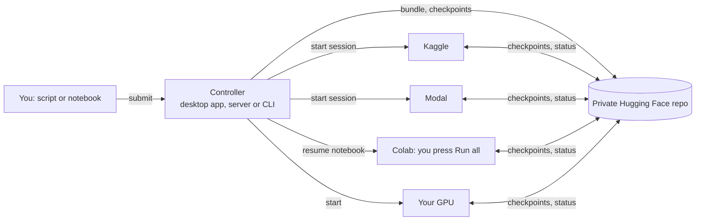

# GPU Relay

Run long machine-learning jobs (training, evaluation, metrics such as FID, preprocessing) to
completion on **free GPU tiers**. GPU Relay checkpoints your job automatically, hands it off
before a session or quota limit is hit, and resumes it on another platform. The final outputs
are the same as an uninterrupted run.

You keep writing ordinary Python scripts or notebooks. Most of them need no changes.

**Live demo:** https://gpu-relay-9uuh.onrender.com (anyone can look; only the owner can change
anything. A free server: the first visit after a quiet spell takes about a minute to wake it.)

## What it does

- **Never lose work to a session limit.** Your job checkpoints at safe points in its loops and
  hands off before a Kaggle session (12 h), a quota, or a Colab disconnect ends it.
- **Use every free GPU hour you have.** One job relays across platforms. The scheduler spends
  credits that expire this month first, then the fastest GPU, then the most hours left.
- **Same results as one long run.** Resumed runs replay your script, restore the variables,
  random generators and files, and continue: logs and outputs match an uninterrupted run.

| Platform | Free allowance | How GPU Relay uses it |
|---|---|---|
| Kaggle | about 30 GPU-hours a week (T4/P100) | automatic, through Kaggle's official API; always private |
| Modal | $30 of compute a month (about 50 T4-hours) | automatic, through Modal's official SDK (you confirm its terms first) |
| Your own NVIDIA GPU | unlimited | automatic; detected with `nvidia-smi` |
| Google Colab | varies, not guaranteed | manual: GPU Relay prepares a resume notebook, you press Run all |
| Lightning AI | some credits a month | built in, off until you review its terms |
| Paperspace | free notebooks are public | not used: GPU Relay keeps your code and data private |

## Three ways to use it

### 1. Desktop app (Windows)

Download `GPU-Relay-<version>-windows-x64.zip` from the
[Releases page](https://github.com/sailokesh3229/GPU-Relay/releases), unzip it anywhere and run
**GPU Relay.exe**. No Python needed for Kaggle, Modal and Colab.

- A setup wizard asks where GPU Relay runs (**this computer** or **your server**), then for
  your Hugging Face, Kaggle and (optional) Modal tokens. Tokens go to Windows Credential
  Manager or the platforms' own token files, never into config files or logs.
- The window shows your jobs, a job's relay timeline and live log, the GPU budgets, and a
  Submit screen with a resumability check. Closing the window keeps GPU Relay running in the
  tray; it notifies you when a job finishes or needs you on Colab.
- Running jobs on your own computer from the packaged app needs Python 3.10+ installed
  (python.org); GPU Relay prepares its own environment on first use.

### 2. Always-on website (server)

`gpurelay serve` runs the controller and the same web app on a server, so jobs keep relaying
while your laptop is off. The repo includes a one-click setup for Render's free plan:

1. Push this repo to GitHub.
2. In Render, choose **New → Blueprint** and pick the repo (`render.yaml` sets it up).
3. Enter the secrets Render asks for: `HF_TOKEN`, `KAGGLE_API_TOKEN` and
   `GPURELAY_OWNER_PASSWORD` (12+ characters).

Anyone with the URL can look (`GPURELAY_PUBLIC_VIEW=1`); the owner logs in to submit, pause
or cancel. The server's disk is wiped when it restarts or sleeps, so it backs up its job list
to your private storage repo and restores it on start. The desktop app can show your server
("My server" in its setup) and notify you about its jobs.

### 3. Command line

```bash
python -m venv .venv && . .venv/bin/activate   # Windows: .venv\Scripts\activate
pip install ".[kaggle,dashboard]"              # extras: desktop, modal, torch, tf, hf, ...

gpurelay init --local                          # try it with storage on this computer only
gpurelay analyze examples/quickstart.py        # will it resume? (FULL = yes)
gpurelay run-local examples/quickstart.py --simulate-kill-every 7s
```

`run-local` hard-kills the job every 7 seconds and resumes it from its last checkpoint; the
final log and `result.json` match `python examples/quickstart.py`. For free GPUs:

```bash
gpurelay init                       # private Hugging Face storage repo + Kaggle
gpurelay submit train.py            # upload the job
gpurelay up                         # the controller: schedules, hands off, notifies
gpurelay status                     # progress, ETA, GPU budget (or: gpurelay app / dashboard)
gpurelay fetch <job-id> --to out    # outputs: log.txt, files/, figures/, report.json
```

## How it works



- **Checkpoints at safe points.** The outermost `for` loop of each long block is instrumented
  automatically. At a safe point the runtime snapshots your variables (PyTorch models and
  optimizers, NumPy arrays, plain Python objects), random number generators and working files,
  and uploads them. Hugging Face Trainer, Lightning and Keras jobs use their own checkpoints.
- **Hand off before the limit.** Each session gets a deadline below the platform's limit. Near
  it, the job checkpoints and exits cleanly; the controller starts the next session elsewhere.
- **Resume by replay.** A new session re-runs your script, skips finished loops, fast-forwards
  to the checkpoint, restores the state and continues. Output already printed is not repeated.
- **Budgets in any unit.** Kaggle grants hours a week, Modal dollars a month, Lightning
  credits; GPU Relay keeps its own ledger of GPU time and converts.
- **Explicit API when needed.** `import gpurelay as relay` gives `relay.range`,
  `relay.chunks`, `relay.state` and `relay.safe_point` (`docs/sdk.md`). Outside GPU Relay they
  are plain passthroughs.

More: [docs/architecture.md](docs/architecture.md), `docs/automatic-resume.md`,
`docs/controller.md`, `docs/checkpoint-layout.md`.

## Hard rules

GPU Relay follows the platforms' terms:

- One account per service. No account rotation or quota pooling.
- Colab is never automated: GPU Relay only writes a resume notebook; you open it and press Run.
- Kaggle and Modal are automated only through their official API/SDK. Everything GPU Relay
  creates (Kaggle kernels and datasets, the storage repo) is private.
- A new platform is switched on only after its terms are reviewed (`terms_reviewed = true`).
- Secrets never appear in kernel source, notebooks, logs or `config.toml`.

## Limitations

- **Numeric equivalence across GPU models.** Identical outputs are guaranteed for the same
  hardware and library versions. If a job moves between different GPUs, kernels can round
  differently in the last digits. The scheduler prefers the GPU model a job already used.
- **Uninstrumented loops.** `while` loops, loops inside functions and nested loops are not safe
  points by default; `gpurelay analyze` tells you which blocks restart from their beginning.
  Use `relay.range` / `relay.chunks` / `relay.safe_point` there.
- **The controller must be running** for handoffs (desktop app, server or `gpurelay up`).
  Sessions keep working and checkpointing without it, and it picks them up when it returns.
- **Platform limits are estimates.** Correct them on the GPU budget screen or with
  `gpurelay quota set <backend> --used 12h`.
- **Hugging Face allows 128 commits an hour per repo.** GPU Relay stays well under it (about
  48 an hour with one job running) by batching uploads and spacing heartbeats.

## Commands

| command | what it does |
|---|---|
| `gpurelay app` | the desktop app (window, tray, notifications, setup wizard) |
| `gpurelay serve` | controller + web app with a login, for a server |
| `gpurelay init [--local]` | config, storage, Kaggle credentials (or local-only setup) |
| `gpurelay analyze <file> [--probe]` | resumability report, risks, GPU-time suggestions |
| `gpurelay submit <file>` | upload a job (script or notebook) |
| `gpurelay up` | run the controller (scheduling, handoffs, notifications) |
| `gpurelay status [job]` / `quota` | progress, ETA, remaining GPU budget |
| `gpurelay logs <job> [-f]` | merged log |
| `gpurelay pause` / `resume` / `cancel <job>` | applied at the next safe point |
| `gpurelay colab <job>` | the Colab resume notebook and steps |
| `gpurelay fetch <job>` | download outputs |
| `gpurelay dashboard` | the web app on this computer only |
| `gpurelay run-local <file>` | relay a job on this computer (testing; can simulate kills) |
| `gpurelay export-state` / `import-state` | move the controller to another machine |

## Development

```bash
pip install -e ".[dev,dashboard,desktop]"
pytest -m "not integration"      # fast unit tests
pytest -m integration            # kill-and-resume equivalence tests (slower)
ruff check . && ruff format --check . && mypy
python packaging/build_windows.py   # the Windows desktop app (needs PyInstaller)
```

Design and status: `spec.md`, `plan.md`, `docs/progress.md`.
