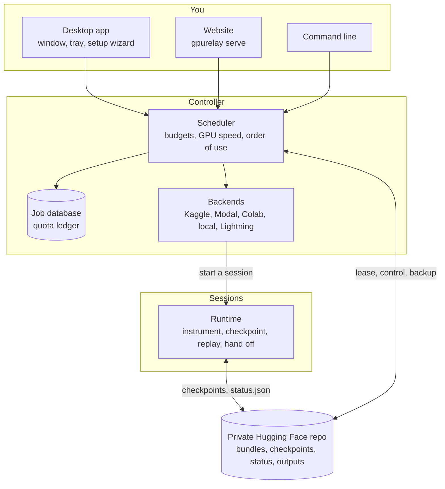

# Architecture

GPU Relay has four parts: the **runtime** that runs inside every GPU session, the
**controller** that decides where each job runs next, the **storage** that connects them,
and the **apps** you use (desktop app, website, command line).

## Runtime (`src/gpurelay/runtime`)

Runs your unmodified script or notebook inside a session.

- **Instrumentation** (`instrument.py`, `loops.py`): rewrites the outermost `for` loops of long
  blocks so each iteration boundary is a safe point. Frameworks with their own checkpoints
  (Hugging Face Trainer, Lightning, Keras) are hooked instead (`hooks/`).
- **Checkpoints** (`state.py`, `persist.py`, `checkpoint.py`): at a safe point, snapshot the
  variables, random generators and working files; upload them as one batch commit, then move
  the `LATEST` pointer (the commit point). Old checkpoints are deleted in the same commit.
- **Watchdog** (`watchdog.py`): checkpoints often enough that at most `max_lost_work_s` of
  work is lost, rarely enough that saving costs under 3 % of GPU time.
- **Replay** (`session.py`): a resumed session re-runs the script, skips finished blocks,
  fast-forwards loops to the checkpoint, restores the state and continues; output already
  printed is suppressed, so the merged log reads like one run.
- **Hand-off**: near the session's deadline the runtime checkpoints and exits with a
  "handoff" code; the controller starts the next session.

## Controller (`src/gpurelay/controller`)

A loop (`daemon.py`) that every `poll_interval_s`:

1. reads each running session's `status.json` (heartbeat, progress, last checkpoint);
2. closes finished sessions, charging GPU time to the platform's ledger (`quota.py`) up to
   the session's last heartbeat, not to when the controller noticed;
3. plans the next sessions (`scheduler.py`): a job goes to a platform that is ready, has
   budget for at least one minimum segment, and has a free slot. Among those: the job's
   preferred platform; then budgets that expire (monthly, daily) unless their GPU is under
   half as fast as the best one; then the fastest GPU (`gpus.py`, T4 = 1.0); then the most
   hours left. Manual platforms (Colab) come last and ask you to act;
4. applies pause, resume and cancel requests at the next safe point.

Only one controller may run per storage repo, wherever it is: a **lease** in storage
(`lease.py`) that is renewed every 10 minutes and released on a graceful stop.

## Storage (`src/gpurelay/storage`)

A private Hugging Face dataset repo (or Google Drive, or a local folder for testing). Layout:
`docs/checkpoint-layout.md`. Hugging Face allows 128 commits an hour per repo, so every
related write shares a commit: a checkpoint is two commits, a job bundle one, a job's outputs
one, and heartbeats come every 5 minutes (`backends/common.py`, `tests/unit/test_commit_budget.py`).

## Backends (`src/gpurelay/backends`)

| backend | how a session starts | limits |
|---|---|---|
| `kaggle` | a private kernel through the official Kaggle API; the storage token is read from a private Kaggle dataset | weekly GPU quota, 12 h per session |
| `modal` | a Modal Sandbox through the official SDK; the token is a Modal secret | dollar credits a month, 24 h per sandbox |
| `colab_manual` | a resume notebook you run yourself (never automated) | not guaranteed |
| `local` | a subprocess on this computer, on its NVIDIA GPU if it has one | none |
| `lightning` | a Lightning AI job through the official SDK (off until terms are reviewed) | credits a month |
| `simulated` | in-process fake for tests, with injected kills | configurable |

## Apps

- **Web app** (`dashboard/`): FastAPI plus one self-contained page (no external files, data
  inserted as text only). Screens: Jobs, Job detail, Submit, GPU budget, Settings; in the
  desktop app also the setup wizard.
- **Website** (`hosted.py`, `gpurelay serve`): the web app behind a login (owner password,
  optional viewer password or public read-only view), the controller as a supervised child
  process, and the job database backed up to storage (the server's disk is temporary).
- **Desktop app** (`desktop/`): pywebview window over Windows' WebView2, a pystray tray icon
  with notifications, the controller as a child process in "this computer" mode or the
  server's website in "my server" mode, single instance, optional start with Windows. The
  local web app is reachable only from the app's own window (a per-launch key).
- **Command line** (`cli.py`): every operation, for scripts and servers.

## Testing

- **Unit tests** (`tests/unit`, about 490): every module, with fakes for Kaggle, Modal,
  Lightning, Hugging Face and the clock.
- **Integration tests** (`tests/integration`): real kill-and-resume runs of scripts and
  notebooks compared with uninterrupted runs, fault injection on storage, controller
  restarts, parallel chunks, adversarial scripts and a randomized stress test.
- **Live checks**: real Kaggle sessions, the Render deployment and the packaged desktop app,
  recorded in `docs/progress.md`.
